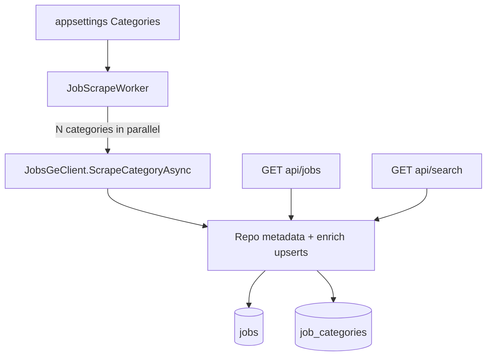

# JobsGeParser

A minimal ASP.NET Core API that scrapes [jobs.ge](https://jobs.ge/) job listings by category, fetches each job's description, and persists results in PostgreSQL. A background worker scrapes each enabled category on a configurable interval.

## Tech stack

| Layer | Choice |
|-------|--------|
| Runtime | .NET 10 (`net10.0`), C# 14 |
| API style | Minimal hosting (`WebApplication`) + extension methods |
| HTML parsing | [HtmlAgilityPack](https://html-agility-pack.net/) 1.11.x |
| Storage | PostgreSQL via EF Core 10 + Npgsql |
| Background jobs | `BackgroundService` (`JobScrapeWorker`) |
| CI | GitHub Actions - `dotnet publish` on `master` |

Requires [.NET 10 SDK](https://dotnet.microsoft.com/download/dotnet/10.0). Repo root [`global.json`](../global.json) pins the SDK version.

## Solution layout

This folder is the **backend** project. The React dashboard lives in [`../frontend/`](../frontend/). Repo overview: [`../README.md`](../README.md).

```
backend/
├── JobsGeParser.sln
├── README.md                 # this file
├── JobsGeParser/
│   ├── Program.cs
│   ├── Alerts/               # matching, channels, rendering, dispatch
│   ├── Configuration/
│   ├── Data/
│   ├── Enrichment/
│   ├── Scraping/
│   ├── Workers/
│   └── Endpoints/
├── JobsGeParser.Tests/
├── JobsGeParser.IntegrationTests/   # alerts against real Postgres (Testcontainers + Docker)
└── JobsGeParser.PerformanceTests/   # live scrape matrix (Testcontainers + Docker)
```

Full monorepo layout:

```
JobsGeParser/                 # repository root
├── README.md
├── AGENTS.md
├── docs/plans/               # backend implementation plans
├── .cursor/
├── backend/                  # ← you are here
│   ├── JobsGeParser.sln
│   └── JobsGeParser/
└── frontend/                 # React dashboard
    └── src/
```

## Architecture



### Scrape flow

1. `JobScrapeWorker` fires on `ScrapeIntervalMinutes`.
2. Enabled categories are enqueued to a bounded `Channel`; **M parallel category consumers** run at once (`CategoryScrapeConcurrency`).
3. Per category:
   - Start a `scrape_runs` row with `CategorySlug`
   - **Discover:** GET listing page 1, then `for_scroll=yes` pages until a page adds no new job ids (jobs.ge repeats the last batch; capped by `MaxListingPages`) → parse metadata → `UpsertMetadataAndLinkCategoryAsync` for every unique job id
   - **Enrich:** only jobs that are new, metadata-changed, or missing `DetailsFetchedAt` are enqueued to a job `Channel`
   - **N parallel enrich consumers** fetch detail pages (bounded by `DetailFetchConcurrency`) → `UpsertDescriptionAsync` (plain text + HTML) → structured enrichment
   - Progress written every `ProgressUpdateInterval` enriched jobs (plus final flush)
   - Run counters include `detailsFetched` and `detailsSkipped` (detail HTTP skipped when metadata unchanged)
4. HTTP requests throttled globally via `ScrapeRequestThrottle` (shared across all categories and detail workers)
5. Categories synced from appsettings on every startup (`CategorySync`).
6. On scrape-worker start (and again on graceful stop), any `scrape_runs` still `Running` are marked `Failed` with an abandon message. That clears orphaned rows left when the process was killed mid-batch; the next tick starts a fresh batch.

Only one app instance should scrape in dev/prod - multiple instances with `ScrapeEnabled: true` duplicate HTTP load.

### Job–category model

- **Many-to-many** via `job_categories` - a job can belong to multiple categories if it appears in multiple listings.
- Job content upsert is still keyed on jobs.ge `Id`; category links are updated separately.

## Configuration

```json
{
  "JobsGeParserOptions": {
    "BaseUrl": "https://jobs.ge/",
    "Categories": [
      {
        "Slug": "it",
        "Name": "IT / Programming",
        "ListUrl": "?page=1&q=&cid=6&lid=0&jid=0",
        "Enabled": true
      }
    ],
    "ScrapeEnabled": true,
    "ScrapeIntervalMinutes": 60,
    "ScrapeOnStartup": false,
    "DetailPageDelayMs": 500,
    "DetailFetchConcurrency": 3,
    "CategoryScrapeConcurrency": 5,
    "HttpClientTimeoutSeconds": 30,
    "MaxListingPages": 50,
    "ProgressUpdateInterval": 5,
    "DefaultJobsPageSize": 20,
    "MaxJobsPageSize": 100
  },
  "Cors": {
    "AllowedOrigins": [ "http://localhost:5173" ]
  }
}
```

| Setting | Purpose |
|---------|---------|
| `Cors.AllowedOrigins` | Browser origins allowed for cross-origin API requests; empty array disables CORS middleware |
| `Categories` | List of scrape targets (slug, name, list URL, enabled) |
| `Categories[].Slug` | Stable key for filtering (e.g. `it`) |
| `Categories[].ListUrl` | Relative listing URL on jobs.ge (page 1; scraper paginates with `for_scroll=yes`) |
| `ScrapeEnabled` | Kill switch for background scraping |
| `ScrapeIntervalMinutes` | Minutes between scrape ticks (all categories per tick) |
| `DetailPageDelayMs` | Minimum ms between HTTP request starts (global across all parallel workers) |
| `DetailFetchConcurrency` | Max parallel detail-page fetches per category (default 3) |
| `CategoryScrapeConcurrency` | Max categories scraped in parallel per tick (default 5) |
| `HttpClientTimeoutSeconds` | Timeout for jobs.ge listing and detail HTTP requests (default 30) |
| `MaxListingPages` | Safety cap on listing pages per category, including infinite-scroll batches (default 50) |
| `ProgressUpdateInterval` | Update `scrape_runs` counts every N completed jobs (default 5) |
| `DefaultJobsPageSize` | Default page size for `GET /api/jobs` (default 20) |
| `MaxJobsPageSize` | Maximum allowed `pageSize` query param (default 100) |

Add more categories by appending entries with their jobs.ge list URLs.

### Alerts configuration

All under the `Alerts` section, disabled by default with console providers, so a fresh clone runs the whole opt-in flow with no credentials.

| Setting | Purpose |
|---------|---------|
| `Enabled` | Master switch. When false no outbox row is written and no alert worker starts |
| `TokenSecret` | Derives manage and unsubscribe tokens. **Never in appsettings**; changing it invalidates every existing link |
| `PublicBaseUrl` | Base for the `/a/...` capability links that go into messages |
| `DefaultTimeZoneId` | IANA zone for a subscriber who does not supply one (default `Asia/Tbilisi`) |
| `EventSettleDelaySeconds` | Delay before an event is claimable, letting a scrape tick finish linking (default 60) |
| `OutboxDrainIntervalSeconds` / `OutboxBatchSize` | Drain cadence and batch size |
| `SendIntervalSeconds` / `SendBatchSize` / `MaxSendAttempts` | Send cadence, batch size, attempt budget |
| `RetryBaseDelaySeconds` / `RetryMaxDelayMinutes` | Exponential backoff bounds |
| `ChannelFailureThreshold` / `ChannelCooldownSeconds` | Pause a channel after repeated transient failures; messages skipped during a cooldown do not consume an attempt |
| `MaxConfirmationsPerAddressPerDay` / `MaxConfirmationsPerDay` | Per-address and global caps on the one endpoint that messages arbitrary addresses |
| `MaxSubscriptionsPerSubscriber` | Cap per verified address (default 10) |
| `Email.Provider` | `Console` logs instead of sending; `Postmark` sends for real and requires `ApiKey` and `FromAddress` |
| `Sms.Provider` | `Console` only for now; any other value fails at startup rather than silently dropping messages |
| `Email.MaxDigestItems` / `Sms.MaxDigestItems` | Jobs listed in one digest before "and N more" |
| `Sms.MaxLength` | Hard cap on a rendered SMS body (default 320, two GSM-7 segments) |
| `*.RetryAfterClaimTimeout` | Whether a message stuck in `Claimed` is retried. True for email (a duplicate beats a lost alert), false for SMS (a duplicate costs money) |

Secrets go in user secrets or environment variables, never in `appsettings.json`:

```bash
dotnet user-secrets set "Alerts:TokenSecret" "<random value>" --project JobsGeParser/JobsGeParser.csproj
```

## API endpoints

Base URL (development): `http://localhost:50423`

### Jobs

| Method | Route | Behavior |
|--------|-------|----------|
| `GET` | `/api/jobs/categories` | Categories with `jobCount` and `latestScrapeRun` per slug |
| `GET` | `/api/jobs` | Paginated job list (`?page`, `?pageSize`, `?category`, `?q`) - no descriptions |
| `GET` | `/api/jobs/{id}` | Single job with full description, structured fields, and category slugs |
| `GET` | `/api/jobs/dotnet` | Paginated `.net` title filter (same query params as list) |

### Search

| Method | Route | Behavior |
|--------|-------|----------|
| `GET` | `/api/search` | Ranked FTS over title/company/description (`?q` required, `?category`, `?page`, `?pageSize`); trigram fallback when FTS empty; cards include structured fields |

### Scrape management

| Method | Route | Behavior |
|--------|-------|----------|
| `GET` | `/api/jobs/scrape/overview` | **Full picture**: worker state, active runs, latest per category, recent runs & batches |
| `GET` | `/api/jobs/scrape/worker` | Live background worker state (current tick, category, run id) |
| `GET` | `/api/jobs/scrape/runs` | Paginated run history (`?status`, `?category`, `?batchId`, `?limit`, `?offset`) |
| `GET` | `/api/jobs/scrape/runs/active` | All runs with status `Running` |
| `GET` | `/api/jobs/scrape/runs/{id}` | Single scrape run by id |
| `GET` | `/api/jobs/scrape/batches` | Recent scrape ticks (grouped runs sharing a `batchId`) |
| `GET` | `/api/jobs/scrape/batches/{batchId}` | All runs in one tick |
| `GET` | `/api/jobs/scrape/status` | Latest run per enabled category (legacy shortcut) |
| `GET` | `/api/jobs/scrape/status/{slug}` | Latest run for one category |
| `POST` | `/api/jobs/scrape/enrichment/backfill` | Re-extract structured fields for stale rows (`?limit`, default 100); returns `{ processed, remaining }` |

### Alerts

Registered only when `Alerts:Enabled` is true. The capability token goes in an `X-Alert-Token` header, never a query string.

| Method | Route | Behavior |
|--------|-------|----------|
| `GET` | `/api/alerts/criteria-options` | Values a filter may use for each faceted criterion |
| `POST` | `/api/alerts/preview` | Jobs a filter matches right now; sends nothing |
| `POST` | `/api/alerts/subscriptions` | Create a subscription and send a confirmation; always `202`, never reveals whether the address was known |
| `POST` | `/api/alerts/confirm` | Prove ownership of an address; returns the manage token once |
| `GET` | `/api/alerts/subscriptions` | Subscriptions for the token in the header |
| `PATCH` | `/api/alerts/subscriptions/{id}` | Rename, change cadence, or replace the filter |
| `POST` | `/api/alerts/subscriptions/{id}/pause` | Stop alerting without deleting |
| `POST` | `/api/alerts/subscriptions/{id}/resume` | Resume, starting from now rather than replaying the backlog |
| `DELETE` | `/api/alerts/subscriptions/{id}` | Delete one subscription |
| `POST` | `/api/alerts/unsubscribe` | Stop one subscription, or every subscription for the address |

Capability link targets, served as plain HTML so they work in a mail client's in-app browser:

| Method | Route | Behavior |
|--------|-------|----------|
| `GET` | `/a/c/{token}` | Confirmation link target; activates pending subscriptions and shows the manage token once |
| `GET` | `/a/u/{token}` | Unsubscribe confirmation page |
| `POST` | `/a/u/{token}` | RFC 8058 one-click unsubscribe target, used by the `List-Unsubscribe-Post` header |

## Alerts

A job seeker saves a filter against a verified email or phone number and is notified when a new matching job appears. Alert work never blocks the scrape loop.

**How the decoupling works.** `Repo.UpsertDescriptionAsync` writes a `job_events` row in the *same* `SaveChangesAsync` that persists the enriched job. That one INSERT is the only coupling. Three workers do everything else:

| Worker | Interval | Responsibility |
|--------|----------|----------------|
| `AlertOutboxWorker` | 30s | claim events (`FOR UPDATE SKIP LOCKED`), reverse match, record deliveries, enqueue instant messages |
| `AlertDigestWorker` | 5 min | find digests due in the subscriber's local timezone, batch and enqueue |
| `AlertSendWorker` | 10s | claim messages, send through a channel, record the outcome or schedule a retry |

**Matching runs once, per job, in reverse** ("which subscriptions match this job"): an indexed prefilter over the `text[]` criteria columns, then in-memory substring and salary evaluation, then one batched `websearch_to_tsquery` round trip that reuses the exact semantics of `/api/search`. Both cadences share this path; cadence only decides whether the message goes out now or waits for the digest.

**Why matching triggers on detail fetch, not on listing insert.** The listing phase inserts a job whose description and every enrichment field are still null. `ApplyEnrichment` runs immediately before the save in `UpsertDescriptionAsync`, so that is the first moment the row is coherent enough to evaluate a filter against. `BackfillEnrichmentAsync` deliberately emits nothing: bumping the extractor version would otherwise alert everyone about the entire corpus.

**Two constraints carry the correctness.** `alert_deliveries (SubscriptionId, JobId)` unique is the whole no-duplicate-alerts guarantee, enforced by Postgres rather than by application code. `alert_messages (IdempotencyKey)` unique plus `alert_subscriptions.LastDigestSentOn` (a local calendar date) makes a double digest impossible, including across a DST transition.

**Identity is a verified contact, not an account.** A subscriber is a (channel, address) pair with double opt-in. Manage and unsubscribe tokens are derived by HMAC from the subscriber id and `Alerts:TokenSecret`, so message footers can rebuild the link at send time while the database holds only a hash.

#### Adding a channel

Implement `IAlertChannel` and `IAlertRenderer`, register both, and the registries pick them up. Matching and dispatch do not change.

#### Local development, no provider account needed

With `Alerts:Email:Provider` set to `Console` (the default), `LoggingAlertChannel` logs the rendered message instead of sending it. The full flow works end to end:

1. Set `Alerts:Enabled` to true and `dotnet user-secrets set "Alerts:TokenSecret" "<random value>"`.
2. `POST /api/alerts/subscriptions`.
3. Read the confirmation URL out of the console log and `POST /api/alerts/confirm` with its token.
4. Run a scrape; the instant alert body prints to the console.

## Database

Tables: `jobs`, `categories`, `job_categories`, `scrape_runs`, and the alert tables `job_events`, `alert_subscribers`, `alert_subscriptions`, `alert_deliveries`, `alert_messages`.

`jobs` includes generated `SearchVector` (FTS), optional `DescriptionHtml`, and enrichment columns (`SalaryMin`/`Max`, `City`, `WorkMode`, etc.). Requires PostgreSQL `pg_trgm` extension (created by migration).

Migrations:

```bash
dotnet ef database update --project JobsGeParser/JobsGeParser.csproj --startup-project JobsGeParser/JobsGeParser.csproj
```

Run from the `backend/` directory, or prefix paths with `backend/` from the repo root.

On startup: categories synced from config; existing jobs without a category are backfilled to `it`.

## Development

```bash
dotnet run --project JobsGeParser/JobsGeParser.csproj
```

Set PostgreSQL connection string in `JobsGeParser/appsettings.Development.json`.

In Development, OpenAPI 3.1 document is served at `GET /openapi/v1.json`.

### Dashboard UI

The React dashboard is in [`../frontend/`](../frontend/). Start it separately:

```bash
cd ../frontend
npm install
npm run dev
```

Open `http://localhost:5173`. See [frontend/README.md](../frontend/README.md).

### Performance tests (live jobs.ge)

Requires Docker Desktop (Testcontainers PostgreSQL) and network access to `https://jobs.ge/`.

These tests hit the live site with a curated settings matrix (`DetailPageDelayMs`, `DetailFetchConcurrency`, `CategoryScrapeConcurrency`, `HttpClientTimeoutSeconds`). They are Trait-gated and not run in CI.

```bash
# Matrix (3 categories, MaxListingPages=2): compare settings
dotnet test JobsGeParser.PerformanceTests --filter Category=Performance

# Optional near-production run (all categories, MaxListingPages=5)
dotnet test JobsGeParser.PerformanceTests --filter Category=PerformanceHeavy
```

A Markdown report is written under `JobsGeParser.PerformanceTests/bin/.../TestResults/perf-*.md` when the collection fixture disposes. Compare relative rankings from the same run; absolute numbers vary with jobs.ge load.

### Alerts integration tests

Requires Docker Desktop (Testcontainers PostgreSQL), but no network access and no provider account: the channel is faked, so nothing is sent.

These cover what cannot be proven without a database: `FOR UPDATE SKIP LOCKED` under concurrent drains, the `ON CONFLICT` dedup ledger, the raw reverse-match SQL, full text matching, timezone-aware digest scheduling, and retry and dead lettering.

```bash
dotnet test JobsGeParser.IntegrationTests
```

Unit tests (no Docker):

```bash
dotnet test JobsGeParser.Tests
```

These include a translation suite that compiles every alert criterion through the real Npgsql provider with `ToQueryString()`, so an untranslatable predicate fails in a unit test rather than at runtime in the drain loop.

**Production hosting (optional):**

- **Single host:** Build with `cd frontend && npm run build`, copy `frontend/dist` to `JobsGeParser/wwwroot`, and add `UseStaticFiles` + `MapFallbackToFile` in `Program.cs`
- **Separate host:** Add the UI origin to `Cors.AllowedOrigins` in appsettings (default includes `http://localhost:5173` for Vite dev)

## Plans

See [`../docs/plans/`](../docs/plans/) for archived backend implementation plans.

## AI assistant context

Project-specific Cursor rules and skills live under [`../.cursor/`](../.cursor/). See [AGENTS.md](../AGENTS.md).
